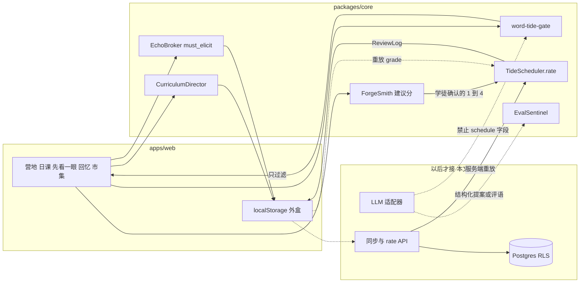
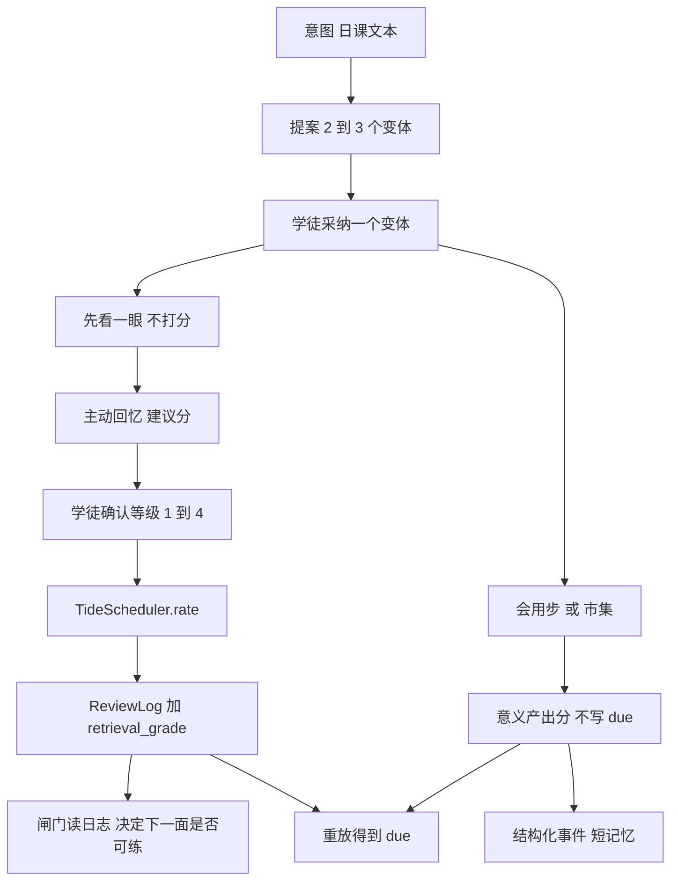
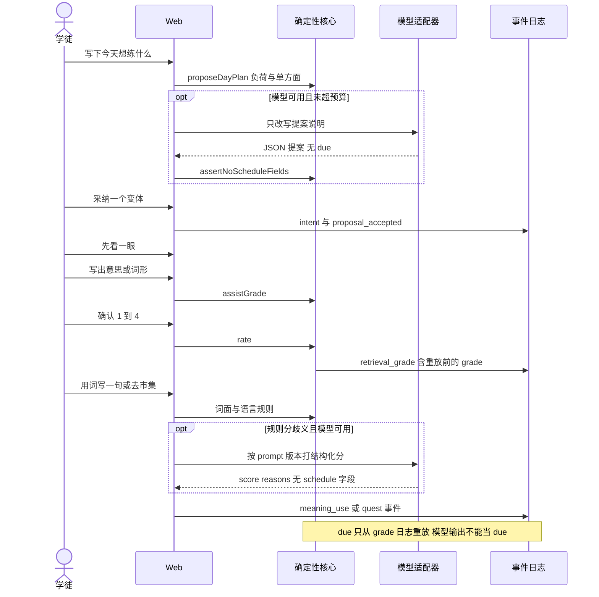
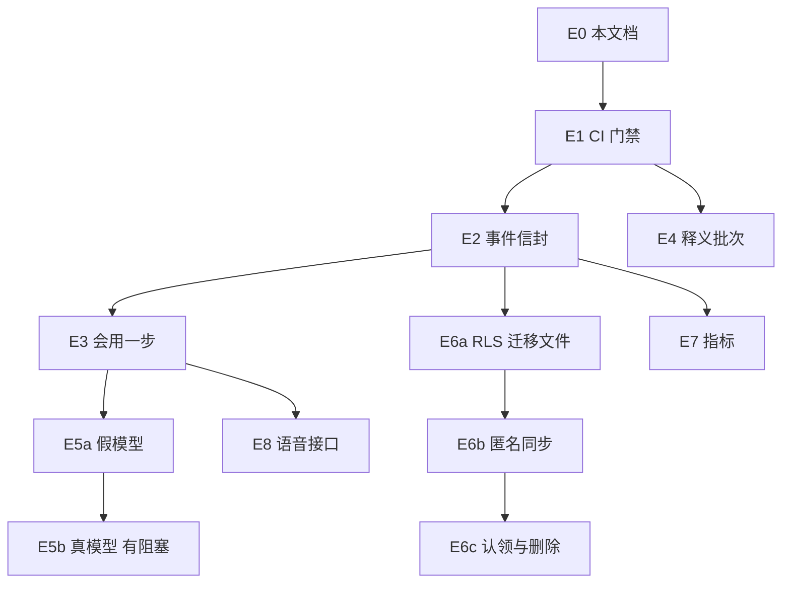

# 言灵残片 · 演进架构与技术实施方案

**日期**：2026-11-09（Asia/Shanghai）  
**基线**：`bcc2b4a59557e23139fc4ac1434eeeb1391b8fc4`（短 SHA `bcc2b4a`），分支 `main`，与 `origin/main` 一致。该提交是 PR #8 的合并提交。  
**地位**：技术路线、数据与 AI 边界、以及当时的 PR 序列以本文为准。已定稿的调度硬规则仍以 [word-schedule-contract.md](word-schedule-contract.md) 为准；学徒可见句仍以 [learner-copy-lesson-first-final.md](learner-copy-lesson-first-final.md) 为准。本文不改这两份契约。

**2026-11-11 状态**：第 1 节和第 9 节是 `bcc2b4a` 当天的盘点。「下一 PR 做 E1」「没有 CI」「回忆后还没有会用一步」「评分双击未修」都停在那个时点。PR10–18 已合入 `7389a8a`。学徒可见形态、页面未接入项，以及建议的下一个设计项，见 [product-design-audit-2026-11-11.md](product-design-audit-2026-11-11.md)。那份审核不解除 E4、E5b、E6 的外部阻塞，也不改本文的调度不变量。  
**范围**：只描述可执行、可迭代的技术路线。本文件不实现功能、不部署、不改云资源。  
**线上**：仓库与 [learner-first-path.md](learner-first-path.md) 提到 Workers 地址 `https://echo-shards.1272679088.workers.dev`。本仓库不能证明该地址上的包等于 `bcc2b4a`。下文不把线上当成 main。

图例：

| 标记 | 含义 |
| --- | --- |
| 已实现 | 源码路径上的行为与描述一致 |
| 部分 | 有代码，但只覆盖本机/内存，或小于契约 |
| 未实现 | 仓库没有对应运行路径 |
| 待核 | 不能用本仓库证明（含线上包、浏览器双击、外部审校进度） |

人日是相对工作量，不是日历日期。1 人日 = 一名已熟悉本仓库的工程师的一个专注工作日，不含等人审词、不含云账号审批、不含密钥交接。

---

## 0. 怎么读现有文档

索引见 [docs/README.md](README.md)。读的时候按这个顺序，避免把旧设想当成现状：

| 文件 | 现在怎么用 |
| --- | --- |
| 本文 | 演进架构、数据与 AI 设计、PR 序列、下一 PR |
| [../ARCHITECTURE.md](../ARCHITECTURE.md) | **当前代码**的模块对照。它描述的是已落地的进程内 Agent，不是托管 LLM |
| [word-schedule-contract.md](word-schedule-contract.md) | 调度硬规则。代码默认值在 `WORD_TIDE_CONFIG` |
| [learner-first-path.md](learner-first-path.md) | 2026-11-05 的产品说明。第 3 节是实现前快照；PR5–8 已合入本基线 |
| [ux-p0-pr-plan.md](ux-p0-pr-plan.md) | PR1–4 的历史范围。均已合入 |
| [schema.md](schema.md) + `supabase/migrations/001`–`002` | Postgres **草案**。无客户端、无 RLS、未接入 |
| [ai-native.md](ai-native.md) | 早期工具边界笔记。Agent 类已存在，但是确定性 TypeScript，不是模型调用 |
| [data-requirements.md](data-requirements.md)、[enrichment-pipeline.md](enrichment-pipeline.md) | 词库与审校现状仍然有效 |

---

## 1. 现状盘点

### 1.1 基线与仓库形状

已核实：

- `git rev-parse HEAD` = `bcc2b4a59557e23139fc4ac1434eeeb1391b8fc4`
- `main` 上最近 8 个合并依次是 PR #1 `6f42269`、#2 `1ecc832`、#3 `b84a2b8`、#4 `f9e53f8`、#5 `fc00a1e`、#6 `9da95a9`、#7 `af9c515`、#8 `bcc2b4a`
- npm workspaces：`apps/web`（`@echo-shards/web`）、`packages/core`（`@echo-shards/core`）
- 运行时：`package.json` 的 `engines.node` 为 `>=22`。调查时环境是 Node `v22.23.4`。根 [README.md](../README.md) 曾写「Node ≥ 18」，与 engines 不一致；本次改为 ≥22
- 关键依赖：`next@15.5.28`、`@opennextjs/cloudflare@1.20.13`、`wrangler@4.152.0`、`ts-fsrs@^5.4.2`、`zod@^4.6.7`
- 没有 `.github/workflows`。质量门是本地 `npm run check`
- 仓库内没有 `fetch` 模型 API、没有 `SUPABASE_` 客户端、没有 `.env` 密钥文件（`.gitignore` 忽略 `.env` 与 `.dev.vars`）

### 1.2 用户主路径

冷启动（本机无 `echo-shards.*`）的代码路径：

1. `/` 营地唯一实心动作是「开始今天的练习」（`apps/web/src/components/camp-practice-cta.tsx`，`apps/web/src/lib/today-practice-href.ts`）。无当日计划时去 `/day`。
2. `/day` 一键「先看一眼」：`CurriculumDirector` 提案并接受**意思**变体，写入 `echo-shards.day-plan.v1`，再进 `/look`（`apps/web/src/components/day-desk.tsx`）。
3. `/look` 展示英文、中文义、可选例句，不打分（`apps/web/src/components/look-ahead-gate.tsx`）。收束后进 `/review`。
4. `/review` 无当日 `day-plan` 时不进入抽卡，只给「去日课」（`apps/web/src/components/review-page-shell.tsx`）。有计划时写中文义，服务端 `suggestAspectGrade` 给建议分，学徒点 1–4 后 `TideSteward.rate` → `TideScheduler.rate`。
5. 意思面至少一条 `grade >= 3` 之后，顶栏「潮汐 / 市集」和营地步骤才可点（`hasFirstMeaningSuccess`）。此前灰态文案是「练完一轮再来」。
6. `/quests` 用英文打出 `must_elicit` 里的拉丁词才算成交。中文凑字过不了关（`elicitTokens` 要求 `[a-z][a-z'-]{3,}`）。Quest 不写 FSRS 卡。
7. 页脚「清空练习记录」确认后删除本机 `echo-shards.*` 并回到 `/`（`apps/web/src/lib/clear-practice-local.ts`）。词表在构建包里，不在 localStorage。

| 能力 | 状态 | 依据 |
| --- | --- | --- |
| 先看一眼再回忆 | 已实现 | `/look` 不调用 `rate` |
| 首成功前导航收敛 | 部分 | 顶栏与营地步骤已灰。工坊（词库、审校）仍可开。直接打开 `/quests`、`/eval` 没有同等拦截 |
| 无 day-plan 时裸进 `/review` | 已实现 | `ReviewPageShell` 改走日课 |
| 同 lemma 同日单方面 | 已实现 | `filterDueByWordTideGate` 只过滤，注释写明不改 `due` |
| 跨睡眠夜再成功才解锁下一方面 | 已实现 | `crossNightSuccessDays` + `dayIdShanghai`；`crossNightSuccessN` 默认 2 |
| 音界默认不进解锁链 | 已实现 | `phonologyInUnlockChain: false`；学徒句「读音暂时不练」 |
| 义→形顺序、N=2 | 已实现为默认 | `WORD_TIDE_CONFIG`。契约写明这不是科学硬结论 |
| 附带阅读不替代词表 | 部分 | 文案 `WORD_TIDE_COPY.incidental` 存在。没有独立的「路上遇见」事件写入闸门 |
| 第一次学完才展开世界观 | 部分 | 主 CTA 与潮汐/市集入口符合。工坊和直链市集仍可在首成功前到达 |
| 记得与会用分轨 | 已实现 | `cards`/`review_logs` 与 `quest_runs` 分表；Quest 成功不调用 `rate` |
| 两轨串联 | 部分 | 日课变体可带 `include_quest`，一键路径选的是意思变体并进入先看一眼，不强制接上市集。市集成功不回写该词的方面解锁 |

评分确认函数 `confirmGrade`（`review-session.tsx`）每次点击都调用 `steward.rate`，没有 `onCheck` 那种 `busy` 锁。重复点击有机会对同一张卡打两次分。这是代码路径结论，**浏览器双击未在本次复现（待核）**。

### 1.3 模块

| 模块 | 状态 | 路径与事实 |
| --- | --- | --- |
| Web UI | 已实现 | `apps/web`：`/` `/day` `/look` `/review` `/quests` `/lexemes` `/enrichment` `/eval` |
| 调度 | 已实现 | `packages/core/src/scheduler/TideScheduler.ts`。唯一写 `due` 的是 `rate()`。无 `setDue` |
| FSRS 参数 | 已实现 | 默认 `requestRetention=0.9`、`maximumInterval=365`、`enableShortTerm=true`。可在构造参数覆盖。这是工程默认，不是契约里的科学结论 |
| 编排闸门 | 已实现 | `packages/core/src/agents/word-tide-gate.ts` |
| 六个 Agent 类 | 部分 | `packages/core/src/agents/`。工具是进程内方法。`LearnerMemory` 只在内存里存 ≤280 字，刷新即失，除非某次 demo 把它放进事件日志 |
| 语音 | 未实现 | `packages/core/src/providers/voice-placeholder.ts` 是空接口；`NoVoiceProviders` 不提供实现 |
| 浏览器可导入面 | 已实现 | `packages/core` 的 `.` 导出不含读盘。`./node` 才读 YAML/JSON |

`assertNoScheduleFields` 拒绝载荷里出现 `due` / `stability` / `difficulty` / `elapsed_days` / `scheduled_days` / `reps` / `lapses`（含嵌套）。`TideSteward.rate` 在调用 ts-fsrs **之前**做这道检查。成功之后，学习事件的 payload **会记下**算出来的 `due` 与 `scheduled_days`，当作审计回声，不是第二套写入入口。以后同步时，服务端必须重放 grade 日志，忽略 payload 里的 `due`。

### 1.4 数据

| 项 | 状态 | 事实 |
| --- | --- | --- |
| 浏览器进度 | 已实现 | 三处 localStorage：`echo-shards.day-plan.v1`、`echo-shards.round.v2:{pool}:{aspect}`、`echo-shards.quest-log.v1`。用户 id 写死 `local-learner` |
| 回合恢复 | 已实现 | `TideScheduler.restore` 用 ReviewLog 重放。篡改的 due/stability 与日志链不一致则抛 `TideRestoreError`，UI 重新入队 |
| CLI 文件账本 | 部分 | `FileEventStore` 写入 gitignore 的 `.data/`。网页不读它 |
| Supabase | 未实现 | 仅有 `supabase/migrations/001_text_foundation.sql`、`002_content_and_events.sql`。全库搜索无 Supabase 客户端。SQL 里没有 `RLS`、没有 `auth.uid()` |
| 学习日 | 已实现 | `dayIdShanghai` 固定 `Asia/Shanghai`。不是设备时区，也不是账号时区 |
| 营地 XP / 残片 | 已实现 | `progressFromEvents`：grade×10，市集成交 +50，`session_end` +5，每 5 次提取 +1 残片。这是本机活动计数，**不能**当成学会 |
| schema 版本 | 部分 | 只有 localStorage 的 `version: 1/2`。没有跨端 `schema_version` 表 |
| 幂等 | 部分 | 营地合并按事件 id 去重。`rate` 本身没有客户端幂等键 |

清空键的实现按前缀 `echo-shards.` 全删，注释里的白名单只是说明。以后若把同步游标也放在这个前缀下，演示清空会把它一起删掉。这是预期的本机卫生，也是以后迁移要写进键清单的原因。

### 1.5 内容

用 `content/lexemes/ngsl-s-1.2-senses.json` 与 `content/packs/ngsl-s-1.2/pack.meta.json` 计数（2026-11-09）：

| 项 | 数量 | 状态 |
| --- | --- | --- |
| lemma | 721 | 已实现 |
| forms | 2354 | 已实现 |
| senses | 721（当前一词一义） | 已实现 |
| `enrichment_status=ready` | 50 | 已实现。50 行都有 `gloss_zh`、`phonetic_text`、`example_sentence` |
| pending | 671 | 已实现。pending 的 `gloss_zh` 均为空 |
| partial | 0 | 已实现（枚举存在，数据里没有） |
| 种子词 | `seed-en-zh-5.json` 5 条 | 已实现。日课默认池可与 ready 行一起出现 |
| 审校队列 | `enrichment-queue.json` 25 条，`pending_total: 671`，生成时间 `2026-10-25T07:46:53.820Z` | 已实现。队列不是新的发布版本 |
| 静态 Quest | 2：`echo-bazaar-info-gap-01.yaml`、`echo-camp-supply-02.yaml` | 已实现。`data-requirements.md` 里「1 个 demo」已过时，本次改掉 |
| 生成 Quest | 1 个 JSON 样例 | 部分。`draftQuest` 是模板拼接，不是模型 |

许可分层已落在 `content/packs/ngsl-s-1.2/NOTICE` 与 `CITATION`：词表 CC BY-SA 4.0（Charles Browne & Brent Culligan）；应用代码 UNLICENSED。`enrichment:validate` 要求 pending 空中文义，且 pending 数 `< 600` 会失败，用来防止有人一次性灌入假释义。网页对 pending 显示「待审校」，不显示编造的中文义。

`data-requirements.md` 里的 Webb/BBC 与 Nation (2006) 链接仍是仓库内可追溯材料。它们约束的是**词表覆盖不等于会说**，不是「721 词已经够开口」。

### 1.6 AI

未实现「模型进入练习主循环」。

已实现的是同名边界上的确定性程序：

| 名字 | 实际做什么 | 不做什么 |
| --- | --- | --- |
| Curriculum Director | 固定 2–3 个变体，负荷上限 5 词、1 个方面 | 不调用模型，不自动开练 |
| Tide Steward | `getDue`、组批、`rate` | 不手改 due |
| Forge Smith | 锁一个方面；编辑距离 / 子串给建议分 | 建议分不是调度；学徒仍要点 1–4 |
| Echo Broker | 模板 `draftQuest`；`must_elicit` 词面命中 | 不写卡；不判断句子是否真用对了意思 |
| Eval Sentinel | 进程内黄金断言 + 把 grade 归一成 0–1 | 不评生成质量，不评学没学会 |
| Learner Memory | 短句内存 | 不检索、不向量、不跨刷新 |

意思建议分（`assistGrade`）是子串包含：猜的和义项片段互相 `includes` 即为 Good(3)，否则 Again(1)。形与音标：全等为 3，编辑距离 1 为 2，否则 1。建议分不会给出 4。短中文很容易误判成「记得」。学徒可以改选等级，所以误判可以被人盖过去，也可以被人忽略。

`/eval` 页面跑的是这套黄金断言，入口在工坊之外，直链仍在。

### 1.7 评测与工程门禁

| 项 | 状态 |
| --- | --- |
| `npm test` | 已实现：`demo`、`demo:quest`、`demo:policy`、`demo:day`、`demo:eval` |
| `npm run assert` | 已实现：营地账本、残片墙、闸门、PR1–PR8 文案/结构断言 |
| `npm run check` | 已实现：test + assert + typecheck + web build + `enrichment:validate` |
| 生成质量黄金集 | 未实现。现有黄金集是策略与不变量，不是模型输出 |
| 意义产出评分 | 未实现。市集只做词面命中 |
| 离线/线上学习效果 | 未实现。没有留存、依从、焦虑的测量管道 |
| CI | 未实现 |
| 安全扫描、依赖审计门禁 | 未实现。本次不把 `npm audit` 说成已有门禁 |

### 1.8 部署

| 项 | 状态 |
| --- | --- |
| OpenNext 配置 | 已实现：`apps/web/open-next.config.ts` 几乎为空；注释写增量缓存以后可接 R2 |
| Worker 配置 | 已实现：`apps/web/wrangler.jsonc` 名称 `echo-shards`，`nodejs_compat`，`observability.enabled: true`。没有 staging 环境，没有 KV/D1/R2 绑定 |
| 构建目录 | 已实现：日常 `next build` 用 `.next-build`；Worker 构建显式 `NEXT_DIST_DIR=.next` |
| 账号与密钥 | 部分：wrangler 里有 account id（已在仓库，本文不抄写）。没有 API token。部署脚本是 `npm run deploy -w @echo-shards/web` |
| 线上是否等于本 SHA | 待核。不要重复部署来「核对」 |
| 回滚演练 | 未实现。配置里没有记录上一个已知良好版本 |

---

## 2. 目标架构

### 2.1 保留什么

继续用现在的栈：Next.js（OpenNext Workers）+ `packages/core` + ts-fsrs + 仓库内 JSON/YAML 词表。不引入第二套调度器，不把 Supabase 当成第一天就要替换 localStorage 的前提，不把语音放进解锁链。

目标只加三块，而且都贴着现有边界：

1. **可回放的学习事件**是进度的权威。卡上的 `due` 永远由同一套 FSRS 参数重放得到。
2. **模型只出现在提议和评语**，输出先过 schema，失败就退回今天已经在跑的确定性路径。
3. **会用**用单独事件记录，不写入 `TideScheduler.rate`。

### 2.2 明确不选的做法

- 不让模型直接更新卡片。现有 `assertNoScheduleFields` 继续当拒绝层，服务端再挡一次。
- 不把 XP、点击、开页次数定义成学会。
- 不在未审校时把模型中文义 merge 进练习池。
- 不为了「AI-native」并行上向量库、队列集群或微服务。事件表加一列幂等键就够用到跨设备。
- 不把音标打字、短时 ASR 分、朗读完成率写成会发音或会说。

### 2.3 模块



实线是 `bcc2b4a` 已有路径。虚线是设计，仓库里还没有。

### 2.4 数据流



「先看一眼」停在认识，不计 N。N 只计该方面、该 lemma、等级 ≥3、且按上海日历日去重的主动提取。这一点保持 `word-tide-gate.ts` 头注释：今天没有独立的再认事件，所以 ≥3 都计入；一旦拆出再认事件，再认默认不计 N。

### 2.5 时序：最小主循环

模型不是聊天侧栏。它只在下面两个虚线框里出现，而且可以被关掉。关掉之后，实线路径就是今天的产品。



权限：

| 动作 | 确定性核心 | 模型 |
| --- | --- | --- |
| 写 due / stability / scheduled_days | 只有 `TideScheduler.rate` | 禁止 |
| 同日留哪一面、音界是否进链 | 闸门读配置 | 禁止改配置，禁止改 due 来「顺延」 |
| 建议回忆等级 | Forge Smith | 可以另给评语；不能跳过学徒确认去 `rate` |
| 日课变体个数与词数上限 | Director，2–3 个、≤5 词、一个方面 | 可以改文案，不能加变体、不能换方面、不能超上限 |
| 市集成交 | `must_elicit` 程序结果 | 可以写下一句提示；不能把 `success` 改成 true |
| 中文义进练习池 | `enrichment:merge` 只收已审校文件 | 禁止 |

---

## 3. 数据设计

本节全部是**设计**。不要把它读成 `001`/`002` 已经有这些列，也不要在未单独获准前连上 Supabase 或执行迁移。字段字典的已有列以 [schema.md](schema.md) 为准，这里只写增量。

### 3.1 从匿名本机到账号

1. **现在**：无账号。权威是这台浏览器里的 ReviewLog 链。
2. **下一档（仍可无云）**：给每条学习事件加 `client_event_id` 与 `schema_version`，本机追加，按 id 去重。导出一份 JSON 即可换浏览器手工导入。
3. **再下一档**：Supabase Auth 的匿名会话。设备首次同步创建 `users` 行。邮箱或 OAuth 是以后的「认领」，不是同步的前提。
4. **认领**：匿名用户升级时把同一 `user_id` 绑到正式身份。不复制一套卡片。

默认：在用户明确允许创建云项目之前，不申请、不连接 Supabase。SQL 可以先以后续 PR 的形式入库，但是否 `db push` 是另一次决定。

### 3.2 增量表与类型（设计）

不新造第二套 `cards`。服务端卡片行是重放结果，客户端快照不是权威。

| 对象 | 增量 | 说明 |
| --- | --- | --- |
| `learning_events` | `schema_version int not null`、`client_event_id text not null`、`study_day text not null`、`device_id text` | `unique (user_id, client_event_id)`。`study_day` 用上海日历日，与 `dayIdShanghai` 相同算法 |
| `review_logs` | `client_event_id text` 可空直到迁移完成 | 与对应 `retrieval_grade` 事件一对一。重放只读 `grade` 与 `reviewed_at` |
| `ai_invocations` | 新表 | `id`、`user_id`、`prompt_id`、`prompt_version`、`provider`、`model`、`tool`、`status`（ok/timeout/invalid/fallback/budget）、`input_tokens`、`output_tokens`、`latency_ms`、`cache_hit bool`、`created_at`。不存完整自由文本的默认见 3.6 |
| `content_releases` | 新表 | `id`、`pack_id`、`pack_version`、`enrichment_version`、`ready_count`、`pending_count`、`published_at`。练习池只读某个已发布版本 |
| `deletion_requests` | 新表 | `user_id`、`requested_at`、`completed_at`。完成前导出窗口由保留策略决定 |

事件类型在 `002` 的检查约束上**追加**（设计，尚未写进 SQL）：`meaning_use`、`meaning_use_score`、`sync_replayed`、`account_deleted`。不要复用 `retrieval_grade` 记录「用词写一句」，否则闸门会把会用误当成记得。

建议分与确认分分开存：payload 里 `suggested_grade` 与 `grade` 都保留。效果分析要能看出误判被改过。

`progress` 继续由事件派生。不要把 XP 列当成可以来回 PATCH 的权威。

### 3.3 版本、时区、跨夜

- 内容版本与进度版本分开。换 50 条释义不能改 FSRS 参数版本。
- FSRS 参数写进重放头：`fsrs_param_version`。今天的默认是 retention 0.9、max interval 365、short-term 开。改参数是新版本，旧日志仍用旧参数重放，除非单独做迁移实验。
- **默认决定**：学习日继续固定 Asia/Shanghai，即使用户人在别的时区。契约和 `dayIdShanghai` 已经这样写。若改成设备时区，同一夜会因为旅行被算成两天或零天。要改必须单独立项，不能夹在同步 PR 里。
- 跨夜判定继续用「成功等级所在的上海日期个数 ≥ N」，不是「两次点击间隔 8 小时」。

### 3.4 幂等、离线、冲突、回放

权威顺序：

1. 追加 `retrieval_grade`（含 `client_event_id`、`card_id`、`grade`、`reviewed_at`）。
2. 用与客户端相同的 ts-fsrs 参数按 `reviewed_at` 排序重放。
3. 得到的 `due` 覆盖卡行。载荷里自带的 `due` 丢弃。

幂等：同一 `client_event_id` 再送一次，返回已有结果，不第二次 `rate`。这同时补上今天评分按钮可能双击的洞。

离线：本机外盒按时间顺序排队。恢复网络后整包上传。服务端按 id 去重后再重放。

冲突：两台设备都练过同一张卡时，不做「后写的 due 获胜」。把两边的 grade 日志并成一条时间线再重放。时钟明显倒退的日志标 `clock_skew`，仍保留，不静默丢弃。

失败重试：同步 HTTP 最多自动重试 1 次，且只在网络错误或 503。4xx 校验失败不重试。模型调用另计，见第 5 节。

### 3.5 现有 localStorage 怎么迁

| 键 | 版本 | 迁移 |
| --- | --- | --- |
| `echo-shards.day-plan.v1` | 1 | 读出 `day_id`、`variant`、嵌入的 `event_log`。过期日（不等于今天上海日）继续视为无计划，与 `hasTodayDayPlan` 一致 |
| `echo-shards.round.v2:*` | 2 | `tide.logs` 是迁移源。每条 log 若没有 `client_event_id`，用 `card_id + reviewed_at + grade` 派生稳定 id，避免重复导入 |
| `echo-shards.quest-log.v1` | 1 | 只迁 `quest_success` / `quest_fail` / `must_elicit_*` / `abandon`。不把市集成功写成回忆等级 |
| `echo-shards.proto.*` | — | 原型污染。迁移时忽略，清空时仍可删 |

读入规则：未知 `version` 不抛掉用户数据，进入「只读导出」并提示清空前先下载。禁止用今天的「清空练习记录」当迁移手段。

`restore` 已有的校验继续用：对不上日志链的 due 不能成为服务器卡。

### 3.6 隐私、保留、删除

现在没有账号，进度只在本机。清空按钮的文案已经说明只清这台设备。

设计默认：

- 账号删除：删除该 `user_id` 的卡片、日志、事件、记忆、AI 调用计量、进度。内容词表不删。
- 模型提示词与学徒自由文本：默认不长期保存原文。保存结构化分、理由枚举、token 数、prompt 版本。若某次评测需要原文，保留 30 天再删，并且导出里单独勾选。这是假设，不是已生效政策。
- 语音阶段之前不采集音频。语音阶段默认不留录音，只留转写是否被学徒确认过。
- 记忆仍禁止整段对话进提示词。沿用 280 字上限，直到有替换设计。
- 词表与释义不是个人数据。CC BY-SA 的署名义务不因删号消失。

### 3.7 密钥

| 秘密 | 放哪 | 不放哪 |
| --- | --- | --- |
| Cloudflare API token | 部署者本机或 CI secret | 仓库、PR、日志 |
| Supabase service role | 仅 Worker 服务端 secret | 浏览器包、Next 公开环境变量 |
| 模型 API key | Worker secret，按环境拆开 | 客户端、`wrangler.jsonc` |
| 学徒会话 | Supabase 用户 JWT | 不要用 service role 代替用户身份 |

浏览器只拿 anon key 时，也必须有 RLS。没有 RLS 的 anon key 等于公开数据库。所以 E6 在 RLS 落地之前不发行 anon key。

Worker 名今天只有 `echo-shards`。接密钥之前先加一个非生产环境名，避免试密钥打到正在给人用的地址。

### 3.8 不重复造的接口

已经存在、继续用、不要平行再写一套：

- `TideScheduler.rate` / `snapshot` / `restore`
- `suggestAspectGrade`（`apps/web/src/app/review/actions.ts`）在被服务端重放替代之前仍是建议分
- `filterDueByWordTideGate`、`assertNoScheduleFields`
- `checkMustElicit`、`draftQuest`
- `enrichment:validate|queue|merge`

设计中的 HTTP（以后的 PR，现在没有这些路由）：

- `POST /api/schedule/rate`：体里只有 `client_event_id`、`card_id`、`grade`、`reviewed_at`。出现 schedule 字段即 400。
- `POST /api/sync/events`：批量事件，按 `client_event_id` 幂等。
- `GET /api/sync/replay`：返回日志与参数版本，不返回「请信任这个 due」。
- `POST /api/ai/score-meaning`：返回分与理由。响应 schema 拒绝 schedule 字段。它不调用 `rate`。

---

## 4. 内容流水线

目标：671 条 pending 变成可练，且练习里不出现未经审校的中文义。

### 4.1 现在就能重复的步骤

```bash
npm run enrichment:queue      # 默认下一批，只带上游英义，gloss_zh 为空
npm run enrichment:merge -- --from path/to/reviewed.json
npm run import:ngsl-s
npm run enrichment:validate
```

`reviewed.json` 的行必须自带 `gloss_zh`、`phonetic_text`、`example_sentence`，并把状态标成已审校。缺字段的行 merge 会拒绝。不要用模型填空来通过校验。

### 4.2 发布版本

每次合并进练习池，记一个 `enrichment_version`（设计：`ngsl-s-1.2+zh.N`）。`pack.meta.json` 的 `stats` 与 senses 文件一起提交。队列文件是工作草稿，不是发布。

来源与许可保持现在的分层：

- `content/packs/ngsl-s-1.2/`：上游词表，CC BY-SA 4.0，NOTICE 与 CITATION 随包走。
- `content/lexemes/`：自研释义、音标文字、例句。引用了 lemma 就要在发布说明里指向 NOTICE。
- 上游 `gloss_en` 只作编辑参考，界面继续标明「上游英义」，不能冒充审校中文义。

校验：

- pending ⇒ 空 `gloss_zh`（已有）
- ready ⇒ 三条核心字段都在（已有）
- 不把 partial 送进 `readyLexemes` 练习池（`readyLexemes` 现况只放行 ready；保持）
- 同一 `enrichment_version` 的 ready 数、pending 数写入 `pack.meta.json`，PR 描述里写出来

禁止：为了把 pending 数维持在 validate 的 600 阈值以上而留着假 ready，或者反过来用模型一次性填满 671 条来压过阈值。阈值是警报，不是目标。

### 4.3 批次

下一批工程上仍用队列里的 25 条（频级靠前的 pending，当前从 `up`、`mean` 一带开始）。人审通过才 merge。

假设：一名编辑审 25 个 lemma（中文义、IPA 文字、一条例句、对一下上游英义）大约 0.5–1 个编辑日。671 条约 14–27 个编辑日，只能分批。这不是工程人日，也不是承诺排期。模型可以出草稿，但草稿文件的状态必须保持 `needs_review`，不能当 `reviewed`。

---

## 5. AI 编排

### 5.1 何时才调用模型

默认关闭。下列情况才调用，而且都有确定性退路：

| 工具 | 输入 | 输出 schema | 退路 |
| --- | --- | --- | --- |
| `rewriteProposalCopy` | 已生成的变体 id、方面、词 id、学徒意图 | `{ variant_id, learner_label }`，方面与词 id 必须与输入一致 | 用现有中文标签 |
| `scoreMeaningUse` | lemma、审校义、学徒句子、`prompt_version` | `{ decision: accept/reject/unsure, reasons: enum[] }` | 词面规则：含目标词、不全是中文、长度下限。`unsure` 不当成会用成功 |
| `adaptTurnPhrase` | 缺失的 must_elicit 项 | `{ text }` 且不得包含「标准答案」全文 | 现有 `composeAdaptTurn` |

超时默认 8 秒。超时、JSON 不合法、schema 不符、或检出 schedule 字段：记 `ai_invocations.status`，学徒侧走退路，不把错误显示成「系统坏了请重试整课」。自动重试最多 1 次，且仅限网络超时。

提示词进仓库并带版本，例如以后的 `prompts/score-meaning-use/v1.txt`。调用记录写版本与哈希，不写「当时线上改过但仓库没有」的提示词。

### 5.2 缓存、限流、预算

缓存键：`prompt_version + tool + 规范化输入哈希`。只缓存**不含学徒自由文本**的结果（例如提案短标签若输入只有词 id）。`scoreMeaningUse` 含个人句子，不缓存。

限流默认（假设，可改）：每个用户每天模型调用上限 K=6（提案 1 次 + 意义歧义最多 5 次）。超过则当天剩余练习全走确定性路径。

成本用变量，不写实时单价：

```text
C = A * D * (Tin * Pin + Tout * Pout) + G * (Tgin * Pin + Tgout * Pout) + E
```

- `A`：当月实际走到模型的人数。主路径默认不调用，所以 A 可以远小于日活。
- `D`：这些人的人均月调用次数。上限约 `K * 当月开启天数`。
- `Tin` / `Tout`：实测平均输入与输出 token，以 `ai_invocations` 为准，不事前编造。
- `Pin` / `Pout`：账单上的单价。换提供商就换这两个数。
- `G`：人工触发的真模型黄金集次数。CI 用录好的 JSON 夹具，G 在 CI 里为 0。
- `E`：Workers 与数据库的固定费用，与 token 分开。

停机条件：若月账单接近事先设定的上限 B（B 由维护者填写，本文不猜），适配器返回 fallback，直到下个自然月或有人调高 B。

提供商可替换：核心只依赖「给定 JSON schema 的完成」。不把厂商 SDK 类型漏进闸门或调度器。第一个实现 PR 用假提供商喂夹具，这样没有密钥也能测。

---

## 6. 评测、观测、发布

### 6.1 调度不变量（离线，多数已有）

每次 PR 继续证明：

- 载荷含 schedule 字段会抛 `SchedulePolicyError`，包括嵌套
- 一批只有一个方面
- `rate` 之后 due 是 Date，另一面的卡 id 不同且 reps 仍为 0
- 同日多界 due 撞车时闸门只留一面，且输入卡的 due 字节级不变
- 音界默认锁
- 跨夜成功日按上海日期去重，失败不清零已有成功日
- pending 中文义为空；ready 字段齐全
- 中文市集回合不成交；英文击中 `must_elicit` 才成交

这些分别在 `demo:policy`、`demo:eval`、`assert:word-tide`、`enrichment:validate`。缺的是 CI 把它们变成合入条件。

### 6.2 生成质量与意义产出

黄金集文件（设计，尚未添加）分三组，每组都是输入 → 允许的结构化输出：

1. **策略组**：模型若返回 due，判定失败。已有代码路径，以后把夹具放进仓库。
2. **意义组**：固定 lemma 与审校义。明显用对、明显用错、只重复单词、纯中文、短子串撞车。规则分与模型分都要给出 `accept/reject`。分歧进入人判，不自动改 FSRS。
3. **防误判组**：专打 `assistGrade` 的子串。例如义项很长、学徒只打了一个字。期望是「建议分不可靠」，界面必须让人确认，不能自动 `rate`。

误判指标：建议分与学徒最终确认分不一致的比例。比例高说明该改规则或提示，不能靠多刷卡冲掉。

### 6.3 学习效果、依从、焦虑

可以做的代理（都要分轨）：

| 问题 | 用什么 | 不用什么 |
| --- | --- | --- |
| 记得 | 该方面到期后的再次等级分布；Again 比例；跨夜后仍 ≥3 的比例 | XP、残片、点击 |
| 会用 | `meaning_use` 接受率；市集 `must_elicit` 命中率。二者分开报 | 把市集成功算成 FSRS 记得 |
| 依从 | 上海日是否出现至少一次**完成的**回忆或会用，而不是打开首页 | `session_end` 次数本身 |
| 焦虑 | 可选的一问自陈，默认不挡练习。只与完成率对照，不设「焦虑下降 = 学会」 | 用停留时长代替 |

线上评测在有服务端事件之后才有意义。在那之前，离线夹具与本机导出是唯一诚实的来源。不要把 Workers `observability.enabled` 当成已经有学习指标。那个开关只说明平台日志可以开，仓库里没有自定义埋点发到分析后端。

### 6.4 CI、安全、环境

下一 PR 只做门禁：在 GitHub Actions 里对 pull request 与 `main` 跑 `npm run check`。Node 22。不部署。

之后单独的 PR 才考虑：

- 依赖漏洞是否挡合并（先看审计结果再决定严重级别，不在本文假装已经跑过）
- preview Worker 与生产 Worker 分名。生产密钥不出现在 preview
- 发布记录：部署的 git SHA 写在发布说明里。回滚是把流量指回上一个记录过的 SHA，而不是在生产上现场改
- 存储兼容：读旧 localStorage 的 PR 必须带一条「旧 v2 回合仍能 restore」的断言，再允许改键名

本方案不执行部署，也不把「再部署一次 main」列进默认序列。线上包与 `bcc2b4a` 的差异待核；核对方式是看 Cloudflare 部署记录里的版本，不是再 deploy 一次。

---

## 7. 口语：文字优先的可插拔后续

### 7.1 现在有什么

Quest 的 `modality` 在 Zod 与 SQL 里都是字面量 `text`。语音接口是空的。音界练习是**写出音标串**，闸门默认不把这一面放进解锁链，文案写明不等于开口。

### 7.2 以后怎么接，而不换主循环

同一条 Quest：目标、角色、信息差、`must_elicit` 不变。文字路径继续把键盘句子送进 `checkMustElicit`。语音路径以后只多一步：学徒确认过的转写文本再送进**同一个**函数。转写未确认不能成交。

| 接口 | 规划 | 不做什么 |
| --- | --- | --- |
| ASR | 音频进、文本出。延迟目标在实现时用 p95 测量后再写数字。超时退回打字 | 不把转写置信度当成会说；不把原始音频默认入库 |
| TTS | 可选，给摊主那一句。失败就显示文字 | 不作为学徒得分 |
| 发音分 | 若存在，只进自己的事件 | 禁止映射成 FSRS 的 1–4，禁止推动方面解锁 |

显性反馈：沿用市集现在的做法，缺哪一条信息就说缺哪一条（`composeAdaptTurn`），不靠一段无法复盘的闲聊。

任务重复 / 4-3-2：作为**以后的实验协议**，不是本仓库已证实的效应。仓库里没有 4-3-2 的可追溯文献。在补上文献并单独立项之前，不做进产品默认路径。即便做了，它也是开口流畅的练习结构（同一任务连续缩短时限），不等于词的方面解锁，更不等于音标打字。

### 7.3 证据：只用仓库里能指到的材料

| 材料 | 仓库位置 | 适用 | 不适用 |
| --- | --- | --- | --- |
| Barcroft TOPRA；Kim & Webb 2022；Rowland 2014 | [word-schedule-contract.md](word-schedule-contract.md) 点名，无全文、无效应量 | 陈述记忆：同日单方面、有反馈的提取优先于再认 | 市集开口、流利、WTC。契约自己划了这个范围。本文不补写效应量 |
| Webb / BBC、Nation (2006) | [data-requirements.md](data-requirements.md) 带 URL | 高频词表是地板；覆盖率不是会说 | 不能推出「做完 721 张卡就会对话」 |
| NGSL-Spoken 1.2 约 90% 口语覆盖 | `pack.meta.json` 的 `coverage_note`，署名 Browne & Culligan | 选词地板 | 不是习得实验 |
| 先看一眼 vs 回忆 | 代码与 lesson-first 文档 | 认识不计分；回忆才 `rate` | 仓库写明：还没有独立再认事件，因此今天 ≥3 都计入 N。这是实现限制，不是 Rowland 的结论 |

待实验，不要写成已证实：

- N 取 1、2 或 3
- 方面顺序是否保持义→形
- 音标打字对发音有没有帮助（默认假设是不能当成会发音）
- 短时 ASR 分、跟读完成、4-3-2 是否改善「会说」
- 子串义项评分与人判的一致率

---

## 8. 分阶段实施

原则：一个 PR 一件事；`npm run check` 绿了再开下一个；学徒可见句不回潮黑话；不在功能 PR 里改部署。

### E0 本文档

- **用户价值**：后面的 PR 有同一份现状和同一条红线，不会把草案表当成已经上线。
- **依赖**：无。
- **范围**：本文、文档索引、旧文档的地位说明与过时句。
- **非目标**：不改业务代码，不建 CI，不连云。
- **验收**：文档链接可解析；现状数字能在列出的路径上对上。
- **人日**：本次文档工作。不估成功能人日。

### E1 CI 门禁（唯一推荐的下一 PR）

- **用户价值**：词表和练习的下一次修改，合入前必须跑过「假释义、调度违约、现有学徒路径断言」。学徒不会在一次无门禁的合并里失去「先看一眼」或被灌入假中文义。
- **依赖**：Node ≥ 22。无密钥。
- **范围**：`.github/workflows` 里对 pull request 与 `main` 执行 `npm ci` 与 `npm run check`。
- **非目标**：不新增产品行为，不修双击评分，不接模型，不部署。
- **模块**：只有工作流文件。
- **迁移**：无。
- **验收**：工作流文件存在；故意让 `enrichment:validate` 失败时该工作流变红（用 PR 上的一次试跑或文档化的失败条件）。通过时 `npm run check` 的每一步都执行。
- **完成定义**：main 的保护可以要求这个检查（仓库管理员在 GitHub 上点选，不在应用代码里）。
- **风险 / 回滚**：check 含 Next 构建，CI 分钟数可能偏高。回滚是删工作流文件。若时长不可接受，下一迭代再把 build 拆成单独 job，而不是把测试从门禁里拿掉。
- **人日**：0.5–1。假设 Actions 对这个仓库可用，且不需要额外缓存调试。

### E2 可回放事件信封（仍只在本机）

- **用户价值**：刷新不双计；同一条评分不会因为点两次就改两次 due。导出的日志以后能迁到账号。
- **依赖**：E1 绿。
- **范围**：`client_event_id`、`schema_version`；`confirmGrade` 与同步追加幂等；旧 v1/v2 键仍能读；补一条双击/重放断言。
- **非目标**：不接 Supabase，不改闸门规则，不改文案契约。
- **模块**：`packages/core` 事件日志、`review-session.tsx`、`camp-progress-local.ts`、相应 assert。
- **迁移**：读旧键，写新字段时缺 id 则派生。不批量清空用户浏览器。
- **验收**：同一 id 重放不增加 reps；旧回合夹具仍能 `restore`；篡改 due 仍抛 `TideRestoreError`。
- **风险 / 回滚**：派生 id 算法一旦发布就不能改，否则会重复导入。回滚应用代码可以，已写出的新键要能被旧代码忽略（未知字段不导致崩溃）。
- **人日**：2–4。假设不改 FSRS 参数。

### E3 记得之后的会用一步（确定性）

- **用户价值**：意思回忆做完，当天用这个词写一句，并得到是否用上的明确结果。这不是市集世界观，也不叫会说。
- **依赖**：E2 的事件类型能区分 `retrieval_grade` 与 `meaning_use`。
- **范围**：回忆小结后的一句产出；规则分；写入独立事件；不调用 `rate`。
- **非目标**：不进解锁链，不替代 `/quests`，不接模型，不采集语音。
- **模块**：`apps/web` 回忆小结、`packages/core` 一个纯函数评分器、Eval 夹具。
- **验收**：纯中文失败；不含目标词失败；含目标词且有英文句子结构通过；通过后该卡 `reps` 不变；音界仍默认关闭。
- **风险 / 回滚**：规则分会放行「把单词贴进一句废话」。黄金集里要有这种负例，界面文案不说「你已经会用了」，只说「这句话里用上了这个词」。回滚是隐藏这一步，旧回忆路径保持。
- **人日**：3–5。

### E4 审校并发布下一批释义

- **用户价值**：可练的词变多，而不是 50 个 ready 反复出现。
- **依赖**：E1，避免未校验的 JSON 进 main。人审稿。
- **范围**：最多 25 个 lemma 的已审校 merge + `import:ngsl-s` + meta 计数。一个 PR 一批。
- **非目标**：不一次做完 671；不让模型 merge。
- **模块**：`content/lexemes/*`、`pack.meta.json`。
- **迁移**：旧练习日志仍指向 lemma id。改义项文字不重写历史 grade。
- **验收**：`enrichment:validate` 绿；ready 数 = 50 + 本批实际收录数；新词在先看一眼能看见中文义；pending 仍无中文义。
- **风险 / 回滚**：错误释义会直接被学徒记住。回滚是 revert 该内容 PR。练习日志保留，不删。
- **人日**：工程 0.5–1 / 批。编辑时间见 4.3，另计，且是真正的等待。

### E5 模型适配器（先假后真）

**E5a 假提供商与 schema（推荐在 E5 内先做）**

- **用户价值**：提案句子或意义歧义可以有第二种评语，但关了模型练习完全一样。
- **依赖**：E3 的规则分已经是退路。
- **范围**：适配器、prompt 版本文件、夹具、调用记录结构（可先写在事件里，不强制上云）。
- **非目标**：不申请密钥，不部署，不把模型分写入 due。
- **验收**：夹具中的非法 JSON、含 due 的 JSON、超时，都落到确定性结果；黄金集在 CI 不访问网络。
- **人日**：3–5。

**E5b 接到一个真提供商**

- **依赖**：维护者把密钥放进**非生产** Worker，并写下预算 B。这是外部阻塞。
- **非目标**：不在本文件选择厂商或抄单价。
- **验收**：超 K、超 B、超时都能在日志里看到 fallback；生产 Worker 在 preview 跑通之前不放同一把密钥。
- **人日**：2–4，另加密钥与环境准备，那个时间不在工程人日里。

### E6 账号与跨设备

拆开，避免一个 PR 又改 SQL 又改 UI 又连生产。

| PR | 用户价值 | 范围 | 人日 |
| --- | --- | --- | --- |
| E6a | 还没有用户数据时，表结构先能在本地 Postgres 建起来并被拒绝匿名乱写 | 设计落地为 `003` 迁移：RLS、增量列、服务端重放测试。不 `db push` 到生产，除非另有明确允许 | 2–4 |
| E6b | 换浏览器可以继续同一条日志 | 匿名会话 + 外盒上传 + 重放。本机旧键按 3.5 导入一次 | 3–5 |
| E6c | 以后可以认领账号并删掉云端进度 | 匿名升级、删除级联、导出 | 2–4 |

**非目标**：E6 不改 N、不改方面顺序、不把 Quest 并进 cards。  
**风险**：RLS 写错会泄露别人的日志。验收必须包含「用户 A 的 JWT 读不到用户 B」。没有这条测试就不发行 anon key。回滚：客户端继续只读 localStorage，服务端停同步入口。

### E7 指标

- **用户价值**：维护者能看出人是在到期后还记得，还是只在当天点了很多下。
- **依赖**：E2 的事件足够；有云之后用 E6 的事件。没有云也可以先做本机导出报告。
- **范围**：第 6.3 节的四行报表。焦虑一问默认关。
- **非目标**：不做增长看板，不用点击率当北极星。
- **验收**：报表样本里，只点首页的人不增加「记得」；只刷 Again 不增加跨夜成功。
- **人日**：3–5。

### E8 口语插件

- **用户价值**：想开口时，信息差任务还在，打字路径不被拆掉。
- **依赖**：E3 的会用事件、E5a 的评测方式、音界开关保持关闭。
- **范围（第一个口语 PR）**：只加接口与「发音分不能 `rate`」的测试。不接真实 ASR。
- **其后**：在非生产环境接 ASR/TTS；4-3-2 只有在补齐可追溯文献并得到单独决定后才做实验开关。
- **人日**：接口 PR 1–2。真实语音另计，且依赖供应商与隐私审查。



E4 可以在 E1 之后与 E2 并行，但不要在同一个 PR：内容 revert 不应带走调度修复。E4 的每一批都是独立 PR。

---

## 9. 唯一推荐的下一 PR

**做 E1：给仓库加上跑 `npm run check` 的 CI。**

理由：E2 之后的幂等、E3 的分轨、E4 的假释义防火墙，都要靠同一次检查才不会在下一次合并里退回。E1 不改学徒看见的句子，不需要密钥，不接触 Cloudflare 与 Supabase，回滚就是删除工作流。现在仓库没有 `.github/workflows`，这是后面序列的第一块缺口，而不是又一份设计。

不推荐把「接上某个模型」或「部署 main」当作下一 PR。前者没有评测退路和预算，后者不能在未核对的情况下当成修复，而且本次授权不包含部署。

---

## 10. 决定与阻塞

### 10.1 已采用的默认（有依据，不必再开放一轮讨论才能写代码）

| 决定 | 默认 | 依据 |
| --- | --- | --- |
| 下一 PR | E1 CI | 第 9 节 |
| 学习日 | 继续 Asia/Shanghai | 契约 + `dayIdShanghai` |
| N 与顺序 | 2；义→形；音界不进链 | `WORD_TIDE_CONFIG` 与契约里的「可配置默认」 |
| 进度权威 | grade 日志重放，不信任客户端 due | `TideScheduler.restore` 已是这个语义 |
| 会用是否写入 due | 否 | 契约范围不含市集；Quest 已分表 |
| 释义谁能发布 | 人审文件 + `enrichment:merge` | validate 与 NOTICE |
| 模型 | 先夹具后密钥；主路径可全程不调用 | 仓库今天没有模型客户端 |
| 云数据库 | 先迁移文件与 RLS 测试，不自动创建项目 | 001/002 仍是草案且无客户端 |
| 部署 | 不放进默认序列 | 线上 SHA 待核；避免重复部署 |
| 口语 | 接口可插，不进解锁，不把音标或 ASR 当分 | 占位接口与契约第 4 条 |

### 10.2 真正堵住后续的事

这些没有默认可以冒充完成：

1. **E5b 的密钥、提供商和月上限 B**。没有就不接真模型。E5a 不因此停住。
2. **E6 是否允许创建或写入某个 Supabase 项目**。没有允许，就只把 SQL 留在仓库里用本地数据库测。
3. **E4 的审校人**。工程 PR 不能编造 671 条中文义。队列可以继续生成，发布必须有人签字。
4. **线上 Workers 现在跑的是哪个构建**。要靠部署记录核对。不在实施 PR 里重新部署来回答这个问题。

其余问题用 10.1 的默认推进，不再列成开放问题清单。

---

## 11. 本次核实与未跑的检查

核实过：

- `git rev-parse HEAD` 与 `git log` 的 PR #1–#8 合并
- senses 721 = ready 50 + pending 671；pending 无 `gloss_zh`；ready 三条字段齐全；forms 2354；种子 5；队列 25 / pending_total 671
- 源码路径见第 1 节。全库无模型 SDK、无 Supabase 客户端、无 RLS、无 GitHub Actions
- Node `v22.23.4`

`npm run check` 在本工作区于 2026-11-09 执行通过（exit 0）。开始时没有 `node_modules`，先 `npm ci`（exit 0，831 packages）。`check` 含 test、assert（PR1–PR8）、typecheck、Next.js 15.5.28 production build、`enrichment:validate`。`demo:eval` 会重写 `content/quests/generated/generated-seed-echo-bazaar.json` 并写入 gitignore 的 `.data/`；若与 HEAD 无内容差异，不纳入本 PR。

未做：

- 未部署，未改 Cloudflare，未连 Supabase，未调用模型
- 未在浏览器里点完主路径（文档 PR 不改 UI）。双击评分只作为代码路径风险，标为待核
- 未核对线上 URL 的部署 SHA
- 未跑 `npm audit`，因此不报告漏洞数量
