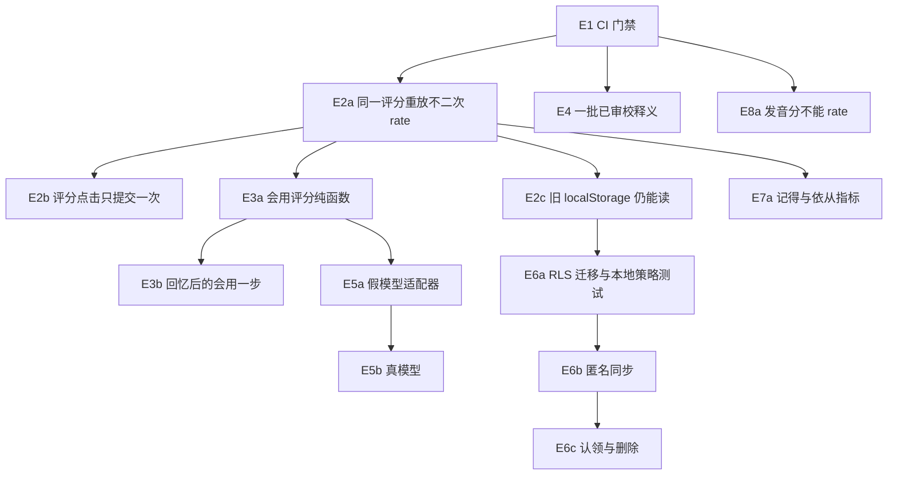

# 实施队列

**日期**：2026-11-09  
**代码基线**：`main` @ `bcc2b4a59557e23139fc4ac1434eeeb1391b8fc4`  
**方案来源**：PR #9（分支 `cursor/evolution-architecture-a575`，提交 `e0d7d96`）里的 `docs/evolution-architecture.md`。该 PR 保持仅文档，本队列不修改它，也不等待它合并。  
**执行**：一次一个 PR。上一项的远程 CI 绿了，才开始下一项。不合并、不部署、不改分支保护、不购买或注册服务、不使用生产凭证、不迁移真实用户数据。

人日仍是相对工作量假设，不是日历承诺。1 人日 = 一名熟悉本仓库的工程师的一个专注工作日，不含审词等待和云账号审批。

## 不变量

这些在每一项里都不得放宽。现有 `npm test`、PR1–PR8 assert、typecheck、build、`enrichment:validate` 继续全部执行，禁止 skip。

| 不变量 | 现在落在哪 | 退化时怎么发现 |
| --- | --- | --- |
| 只有 `TideScheduler.rate` 写 due / stability / scheduled_days | `packages/core/src/scheduler/TideScheduler.ts`，`assertNoScheduleFields` | `demo:policy`、`demo:eval` |
| 同 lemma 同日只练一个方面；撞车只过滤，不改 due | `word-tide-gate.ts` | `assert:word-tide` |
| 下一方面要跨上海日历夜再成功；N=2、义→形是默认，不是新科学结论 | 同上，`dayIdShanghai` | `assert:word-tide` |
| 先看一眼再回忆；首成功前潮汐/市集入口灰掉；无当日计划不进抽卡 | `/look`、`ReviewPageShell`、`hasFirstMeaningSuccess` | `assert:pr5` 到 `assert:pr7` |
| 音界是实验轨，默认不进解锁链；音标打字不是会发音 | `phonologyInUnlockChain: false` | `assert:word-tide` |
| pending 词没有中文义；练习池只用 ready | `enrichment:validate`，`readyLexemes` | `enrichment:validate`、`demo:policy` 的 721/671 |
| 市集成交看 `must_elicit`，不写 FSRS 卡 | `echo-broker.ts` | `demo:quest`、`demo:eval` |
| 模型、语音分、会用分都不是 `rate` 的输入 | 模型与语音尚未接入 | 下面各项的先写测试 |

## 依赖

E4 与 E2 可以在 E1 远程绿之后分叉，但不要进同一个 PR。本轮只做 E1。

---

## E1 CI 门禁

- **状态**：本轮唯一实现项。
- **用户价值**：下一次改练习或词表时，合入前必须跑过现有检查。假释义和调度违约不会在没有门禁时进 `main`。
- **依赖**：无。Node ≥ 22。不需要密钥。
- **范围**：`.github/workflows/check.yml` 在 `pull_request` 与推向 `main` 时执行 `npm ci` 和 `npm run check`。`scripts/assert-e1-ci-workflow.mjs` 锁住这份契约，并挂进 `npm run assert`。
- **非目标**：不改练习行为，不修双击评分，不接模型，不部署，不改分支保护，不把 build 从 `check` 里拿掉。
- **模块**：`.github/workflows/check.yml`、`scripts/assert-e1-ci-workflow.mjs`、根 `package.json` 的 assert 脚本。
- **先写的测试**：工作流文件不存在时断言失败。负例必须失败：没有 `pull_request`、push 不是 `main`、`contents: write`、`npm install`、`npm run deploy`、`secrets.*`、Node 18、不取消旧 run、拿掉 `npm run check`、`pull_request_target`。正例要求：Node 22、`cache: npm`、恰好 `npm ci` 与 `npm run check`、权限只有 `contents: read`、`persist-credentials: false`、`cancel-in-progress: true`、`timeout-minutes` 在 10 到 30。`package.json` 的 `scripts.check` 仍按顺序包含 test、assert、typecheck、build、`enrichment:validate`。
- **局限**：该脚本解析 YAML，不启动 Actions runner，也不做 actionlint 的表达式类型检查。远程 run 才证明安装和 `npm run check` 在 GitHub 上真的跑完。
- **验收命令**：`node scripts/assert-e1-ci-workflow.mjs`，然后 `npm run check`。推送后看该 PR 的 check run，不把本地绿写成远程绿。
- **完成定义**：工作流文件满足契约；远程 check run 成功，或明确记录为权限阻塞且没有开始 E2。
- **回滚**：删工作流文件和 `assert:e1-ci`。产品行为不变。
- **阻塞**：若 Actions 要仓库管理员批准或权限不足，停在报告，不改管理员设置，不开始下一项。
- **人日**：0.5–1。

## E2a 同一评分重放不二次 rate

本项实现后的边界（不是 E2b / E2c）：

- 幂等记录是 `ReviewLog.client_event_id`，随 `TideScheduler.snapshot` / `restore` 走。查找只扫描这份日志。
- 调度器自己不写盘。调用方在 `rate` 返回前崩溃，这次内存修改不会进 localStorage。本项不改浏览器存储。
- 两个 `TideScheduler` 实例的 id 互不可见。没有 restore 的新实例是新范围。
- 学习事件 id 为 `retrieval:${client_event_id}`。相同载荷再送不追加事件，也不再调用 FSRS。
- 快照里的 due 仍只靠日志重放核对。id 不能用来写 due。
- 同 id 而卡、等级或 `reviewed_at` 不同：`TideEventConflictError`，状态不变。
- 没有这张卡、空 id、或载荷含 due：不占用 id。
- `TideScheduler` 和 `AgentEventLog` 不是同一个事务。本项不保证跨进程、跨设备或崩溃原子性。

- **用户价值**：同一条「记得」被送两次时，下次练习时间不会被多推一次。
- **依赖**：E1 的远程 CI 绿。
- **范围**：在 core 给一次 `rate` 增加可选 `client_event_id`。同一 id 再送，返回已有日志，`reps` 与 `due` 不变。不同 id 仍各算一次。不带 id 时行为与现在一致。带 schedule 字段仍然抛错。
- **非目标**：不改页面，不读 localStorage，不接数据库。
- **模块**：`packages/core/src/scheduler/TideScheduler.ts` 或它旁边的一个纯函数，加 `scripts/assert-e2a-rate-idempotent.mjs`，挂进 `npm run assert`。
- **先写的测试**：同一 id 两次调用后 reps 仍为 1，due 时间戳不变；两个 id 则 reps 为 2；空 id 拒绝；载荷含 `due` 仍是 `SchedulePolicyError`；音界默认与同日单方面断言继续绿。
- **验收命令**：`npm run check`。
- **完成定义**：新断言绿，旧 demo 不改 FSRS 参数（retention 0.9、max interval 365、short-term 开）。
- **回滚**：revert。没有新的持久化格式。
- **阻塞**：无。若 E1 远程未绿，本项不开始。
- **人日**：1–2。

## E2b 评分点击只提交一次

本项落地边界：

- 锁在 `createGradeSubmitter` 里，点击和快捷键都走 `submit`。不靠按钮 disabled，也不靠时间窗。
- 第一次点击固定 `client_event_id` 和 `reviewed_at`，再交给 E2a 的 `TideScheduler.rate`。
- 评分已经进内存但 `localStorage` 写入失败时，`saved` 为 false，界面不往下翻。同一次重试沿用同一个 id 和时间，E2a 不会再记一笔。错误原文返回给界面。
- 这次写入若失败后页面被卸掉，内存里的成功记录会丢。磁盘上仍是旧快照。新开的提交器会得到新的 id。本项不把这种情况说成已经保存，也不做跨设备恢复。
- 不迁移没有 `client_event_id` 的旧回合。那是 E2c。
- 浏览器里没有手点评分按钮。行为由 `scripts/assert-e2b-grade-once.mjs` 对真实 `TideScheduler` 调用覆盖，复习页接到同一函数。

- **用户价值**：连点「记得 / 没想起来」不会打出两笔分。
- **依赖**：E2a。
- **范围**：抽出「这一笔是否已经提交」的纯函数，`confirmGrade` 使用 `client_event_id` 和进行中的锁。学徒仍自己点 1–4，建议分不能自动 `rate`。
- **非目标**：不改题面文案，不改闸门，不做跨设备。
- **模块**：`apps/web/src/components/review-session.tsx`，纯函数放在 core 或 `apps/web/src/lib`，新 assert。
- **先写的测试**：同一张卡、同一次揭示，第二次调用返回已提交；换到下一张卡允许新的 id；函数不接收 due。不用只搜索按钮文案来代替这个行为。
- **验收命令**：`npm run check`。
- **完成定义**：测试覆盖双击路径；PR1–PR8 文案断言仍绿。
- **回滚**：revert。旧 localStorage 回合不含新 id 时仍能按 E2c 之前的方式打开；因此 E2b 若先于 E2c，读路径必须忽略未知字段。
- **阻塞**：无。
- **人日**：1–2。

## E2c 旧 localStorage 仍能读

本项落地边界：

- 支持的回合格式是 `version: 2`。没有 `client_event_id` 的日志用 `legacy:` 加上卡片、时间和等级派生稳定 id。已有 id 保持原样。
- 派生只改日志上的 id。不调用 `rate`，所以 due、reps、等级、时间和解锁进度不因迁移而变。同一份记录再读一次不会重写。
- 读不懂、对不上、或两笔撞成同一个 id 时，不删、不覆盖。复习页告诉学徒记录还在。日课、市集和别的词表不受影响。
- 没有另存一份备份键。清空练习记录仍按 `echo-shards.` 前缀删掉这一条。日志里不打印记录正文。
- 写入失败时磁盘上的旧文本还在，内存里可以先打开，界面说明没能更新存下来。
- 不修复 E2b 的情况：评分已经进内存但写盘失败，随后页面卸掉，那一笔仍然会丢。
- 行为测试是 `scripts/assert-e2c-round-compat.mjs`。没有在浏览器里手点恢复。

- **用户价值**：升级后这台设备上已经练过的词还在，而且不会因为导入两次变成两笔分。
- **依赖**：E2a。可与 E2b 的读路径一起做，但单独 PR。
- **范围**：读 `echo-shards.round.v2:*` 与 `echo-shards.day-plan.v1`。缺 `client_event_id` 时用 `card_id + reviewed_at + grade` 派生稳定 id。未知 `version` 不抛掉数据，进入只读并保留导出所需原文。
- **非目标**：不上传，不实现「清空」以外的删云端，不改键名前缀的删除规则。
- **模块**：`apps/web/src/lib/camp-progress-local.ts`、`review-session.tsx` 的读档，新 assert 使用夹具对象而不是浏览器。
- **先写的测试**：同一份无 id 的 v2 夹具导入两次，派生 id 相同且只 rate 一次；损坏 JSON 仍走现有丢弃并重新入队；day-plan 的上海日不匹配时今天仍算没有计划。
- **验收命令**：`npm run check`。
- **完成定义**：夹具绿；`assert:pr8` 仍只删 `echo-shards.*`。
- **回滚**：revert。新写出的未知字段被旧代码忽略才算兼容；若做不到，这个 PR 不能合。
- **阻塞**：无。
- **人日**：1–2。

## E3a 会用评分纯函数

本项落地边界：

- `checkMeaningUse` 只做基础形式检查：词边界上有没有目标词或调用方给出的词形，句子是不是只有这个词，以及是不是太长、空白、纯中文。
- `basic_pass` 的意思是「这句话里有这个词」。`meaning_judged` 恒为 false，`semantic_status` 是 `not_evaluated`。不判断意思是否用对、语法或水平。反馈不说学会。
- 屈折只认 `forms` 列表。没有列表时，`tides` 不算 `tide`。不把 `catch` 当成 `cat`。功能词用同一条词边界规则，不另做一套语法。
- `enrichment_status` 不是 `ready` 时不检查句子，避免未审校词进入会用。不编释义。
- 无 I/O、无时钟、无随机、不调用 `rate`。事件名是 `meaning_use`，不是 `retrieval_grade`。
- 复习页还没接这个函数。那是 E3b。市集的 `checkMustElicit` 仍是另一条轨道，本项不改它。
- 行为测试是 `scripts/assert-e3a-meaning-use.mjs`。

- **用户价值**：一句里有没有用上这个词，可以单独判断，而且不会被记成「记得」。
- **依赖**：E2a，这样结果事件不会复用 `retrieval_grade`。
- **范围**：纯函数。输入 lemma 与句子。纯中文失败；没有目标词失败；含目标英文词且不只是孤零零一个词则通过。返回值没有 grade、没有 due。通过与否不调用 `rate`。
- **非目标**：不放进页面，不叫「会说」，不进解锁链，不接模型。规则会放行「把词贴进一句废话」，文案以后不能写成「你已经会用了」。
- **模块**：`packages/core` 新模块，新 assert。
- **先写的测试**：上面三个语言边界；函数模块源码不引用 `TideScheduler`；事件名是 `meaning_use`，不是 `retrieval_grade`。
- **验收命令**：`npm run check`。
- **完成定义**：断言绿，闸门测试的 N 仍只看回忆等级。
- **回滚**：revert。没有页面入口就没有用户数据。
- **阻塞**：无。
- **人日**：1–2。

## E3b 回忆之后的会用一步

本项落地边界：

- 只有意思练习、而且词在可练词表里，回忆保存成功后才出现「用这个词写一句」。拼写、读音、未审校词不出现这一步。
- 句子交给 `checkMeaningUse`。通过只说「这句话里有这个词。意思用得对不对，还没判断。」跳过会记下来，不算会用。
- 记录在 `echo-shards.meaning-use.v1`，schema 1。不上传，不调用 `rate`。清空练习记录会清掉这个键。
- 写盘失败时原文还在输入框，可以再试。损坏或未知 schema 不覆盖，也不挡住回忆。
- 另一个页面实例看不到还没写成功的句子。不保证跨设备。
- 造句时数字键不打分，Enter 用来看一看。刷新若停在造句，不把这一步当成新的回忆评分。
- 行为测试是 `scripts/assert-e3b-meaning-use-step.mjs`。没有在浏览器里手点这一步。

- **用户价值**：练完意思，当天接着用这个词写一句，并看到用上了还是没有。
- **依赖**：E3a。
- **范围**：意思回合小结后的一步。调用 E3a。写入独立事件。音界默认仍关。先看一眼仍然不计分。
- **非目标**：不替代 `/quests`，不采集语音，不把这一步算进跨夜 N。
- **模块**：`review-session.tsx` 的小结段，新 assert。
- **先写的测试**：小结状态出现会用输入；提交后 `reps` 不变；PR5–PR7 的壳和「先看一眼」断言仍绿。页面测试优先抽纯状态机，不新开浏览器依赖。
- **验收命令**：`npm run check`。浏览器手测本项不作为 CI 的替代。
- **完成定义**：状态机测试绿，且没有自动 `rate`。
- **回滚**：隐藏这一步，回忆路径回到现在的小结。
- **阻塞**：无。
- **人日**：2–3。

## E4 发布一批已审校释义

- **用户价值**：可练的词多于现在的 50 个 ready，而且没有假中文义。
- **依赖**：E1。人交出通过审校的 JSON。
- **范围**：最多 25 个 lemma，走现有 `enrichment:merge` 与 `import:ngsl-s`。一个 PR 一批。
- **非目标**：不一次填完 671；模型草稿不能当 `reviewed`。
- **模块**：`content/lexemes/*`、`content/packs/ngsl-s-1.2/pack.meta.json`。
- **先写的测试**：已有 `enrichment:validate`。本项开始前用缺字段样本确认 merge 拒绝。不新写「文件里出现某个中文词」这种匹配来代替校验。
- **验收命令**：`npm run check`。ready 数 = 50 + 本批实际收录；pending 仍空 `gloss_zh`。
- **完成定义**：校验绿，PR 说明写上新的 ready / pending 计数。
- **回滚**：revert 内容 PR。历史 grade 保留。
- **阻塞**：没有审校人交出的 `reviewed.json` 时，本项不开始。工程代理不编释义。截至 E5a 仍阻塞，没有编造释义。
- **人日**：工程 0.5–1。编辑时间另计。

## E5a 假模型适配器

本项落地边界：

- 只有一个任务：给已经 `basic_pass` 的会用检查附加一条夹具说明。夹具不能改判定，不能把 `meaning_judged` 变成 true，也不能写 due 或调用 `rate`。
- 来源是仓库里的 `packages/core/fixtures/meaning-use-comment.v1.json`，标记为 `recorded-json` 和 `test-fixture-not-learner-data`。提示词版本是 `meaning-use-comment/v1`。
- 非法 JSON、缺字段、类型或长度不对、越权字段、超时、拒绝、抛错、取消，都退回基础检查，并说明没有拿到模型判断。尝试次数最多 2 次。时钟由调用方注入，不睡眠、不联网。
- 基础检查没通过，或词不是 ready，就不会去读夹具。复习页不调用这个适配器。
- 没有供应商 SDK，也没有密钥。真模型是 E5b，现在不做。
- 行为测试是 `scripts/assert-e5a-fixture-model.mjs`。

- **用户价值**：关着模型时，练习和现在一样；打开夹具时，非法输出进不了调度。
- **依赖**：E3a 的确定性退路。
- **范围**：适配器只接受录好的 JSON。输出 schema 拒绝 schedule 字段。超时、非法 JSON、含 due 的 JSON 都落到 E3a 或现有文案。记录 prompt 版本字符串。CI 不访问网络。
- **非目标**：不申请密钥，不部署，不把模型分写成 FSRS 等级。
- **模块**：`packages/core` 新适配器，夹具，新 assert。
- **先写的测试**：三份坏夹具都被拒绝并给出确定性结果；一份好夹具只改写允许的字段（提案短句或会用评语），不改方面、不改词 id、不改 due。
- **验收命令**：`npm run check`，且测试进程没有出站模型请求。断言里不读取 `process.env` 密钥。
- **完成定义**：坏夹具绿，仓库仍无供应商 SDK。
- **回滚**：revert。主路径不调用适配器。
- **阻塞**：无。真模型不在此项。
- **人日**：2–4。

## E5b 接到一个真提供商

- **用户价值**：歧义句可以得到模型评语，超限或超时仍能练完。
- **依赖**：E5a。维护者提供非生产密钥和月上限。
- **范围**：一个提供商实现，密钥只来自环境，不进仓库。每天调用上限与超时退路接上 E5a。
- **非目标**：不选型号单价写进仓库，不把生产 Worker 和生产密钥放进这个 PR，不部署。
- **模块**：适配器的一个实现文件，文档只写变量名不写密钥值。
- **先写的测试**：无密钥时走退路；伪造的超限响应走退路。不在 CI 里打真实接口。
- **验收命令**：`npm run check`。真实调用由维护者在非生产环境手测，结果写进该 PR，不能由 CI 绿代替。
- **完成定义**：代码路径在无密钥时绿。有密钥的手测未做则该项未完成。
- **回滚**：去掉提供商实现，留下 E5a。
- **阻塞**：没有密钥、提供商和预算上限时不开始。本队列的授权不包含购买或注册。
- **人日**：2–3，不含开户。

## E6a RLS 迁移与本地策略测试

- **用户价值**：以后账号库即使配错钥匙，也不能靠匿名钥匙读写别人的练习。
- **依赖**：E2c 的事件形状。
- **范围**：新增 `supabase/migrations/003_*.sql`：RLS、`client_event_id` 唯一、服务端重放所需列。测试在本地数据库或可重复的 SQL 夹具上证明用户 A 读不到用户 B。不 `db push`。
- **非目标**：不创建云项目，不发行 anon key，不把浏览器改去连云。
- **模块**：`supabase/migrations/`，新 assert 或集成测试。
- **先写的测试**：没有 RLS 的夹具失败；有策略后 A/B 隔离通过。只搜索 SQL 文本里有 `ENABLE ROW LEVEL SECURITY` 不够，该项要有一次真的拒绝访问。没有本地 Postgres 时，这项停在阻塞，不拿文本匹配交差。
- **验收命令**：本地数据库测试命令写进该 PR，再加 `npm run check`。
- **完成定义**：A/B 隔离绿，且没有云端变更。
- **回滚**：删迁移文件。应用仍只用 localStorage。
- **阻塞**：本机没有可用的 Postgres 时不假装完成。云端应用迁移另需明确授权。
- **人日**：2–4。

## E6b 匿名同步

- **用户价值**：换浏览器后，同一条 grade 日志还在，due 由重放得到。
- **依赖**：E6a 的本地隔离测试绿，以及允许使用的 Supabase 项目。当前没有这项允许。
- **范围**：匿名会话、外盒按 `client_event_id` 上传、服务端重放。旧键按 E2c 导入一次。
- **非目标**：不把客户端 due 当权威，不迁移生产用户数据，不部署 Worker。
- **模块**：新的服务端 route 或 core 同步函数，web 外盒。
- **先写的测试**：重复上传不增加 reps；载荷里的 due 被忽略；离线队列在失败后只自动重试网络错误一次。
- **验收命令**：`npm run check` 加同步集成测试。
- **完成定义**：测试绿，且用的是获准的非生产项目。
- **回滚**：客户端继续只读 localStorage，关掉同步入口。
- **阻塞**：没有获准的项目和钥匙。不在未授权时注册 Supabase。
- **人日**：3–5。

## E6c 认领与删除

- **用户价值**：匿名进度可以绑到以后的登录，也可以删掉云端副本。
- **依赖**：E6b。
- **范围**：同一 `user_id` 升级。删除级联卡片、日志、事件。词表不删。导出 JSON。
- **非目标**：不采集音频，不把整段对话写进记忆。
- **模块**：E6b 的账号路径。
- **先写的测试**：删除后该用户的日志读不到；另一用户的日志还在；词表行还在。
- **验收命令**：`npm run check` 加该集成测试。
- **完成定义**：测试绿。
- **回滚**：停用删除入口前先保证导出仍可用。
- **阻塞**：依赖 E6b 的授权。
- **人日**：2–3。

## E7a 记得与依从指标

本项落地边界：

- 纯函数 `summarizeLearningEvidence` / `formatLearningEvidence`，版本 `LEARNING_EVIDENCE_VERSION = 1`。不调用 `rate`，不改日志、快照、解锁，不读 XP。复习页和首页都没有接这个函数。
- 新的 `TideSteward.rate` 在调用 `rate` 之前抄下练习前的 `due_before`、`reps_before`、`state_before`、`last_review_before` 和注入的 `reviewed_at`，记为 `evidence_version: 1`。`payload.due` 仍是这次评分之后的 due，指标不读它。旧事件没有这些字段，不回填。
- 到期后自评：分子是去重后的 v1 记录里，`reps_before >= 1` 且 `reviewed_at >= due_before` 且等级为 3 或 4 的次数；分母是同一集合里等级 1–4 的次数。3/4 只是自己点的「记得 / 轻松」，不是测出来的学会，也不是因果效果。分母为 0 时分子、分母、比例都是 null，文案写暂时没有记录，不写 0% 或 100%。
- 新卡（`reps_before === 0` 且 `state_before === 0`）算首次学习，不进到期后的分母。比 `due_before` 早 1 毫秒算提前练，也不进分母。正好等于 `due_before` 算到期。
- 跨夜：同一张卡上，取第一次跨到更晚的上海日历日、并且那次是到期后再练的记录。仍选 3/4 才计入分子。只有 Again 时分子是 0、分母是实际张数。没有这样一对时比例是 null。上海日只用 `reviewed_at`，不用 `created_at`。上海无夏令时。
- 依从：上海日里出现过一次可定日期的回忆或造句（跳过也算做过这一步）。只打开首页、只有 `session_end`、只有市集成交，天数是 0，不增加记得。旧记录没有 `reviewed_at` 时，天数是 null，不写成 0。
- 去重键是 `client_event_id`，没有则用事件 id。同一键、同一签名只计一次。同一键但等级、卡、时间或练习前字段不同，整组排除，并列出事件 id。空键、坏等级、坏时间、版本不是数字 1、reps 和 state 对不上，都排除。不把字符串 `"3"` 收成等级 3。
- 观察窗口 `windowStart` 与 `asOf` 都是闭区间，按瞬间比较。窗口存在时，没有 `reviewed_at` 的旧点击不放进窗口。
- 造句另计：`basic_pass` 且 `semantic_status = not_evaluated` 只表示句中出现目标词。跳过、夹具、以及自称已经判断语义的记录都不算掌握。`semantic_judged_count` 固定为 0。没有造句记录时比例是 null。
- 点击次数是另一栏。XP 不出现在这份报告里。
- 行为测试是 `scripts/assert-e7a-learning-evidence.mjs`。

- **用户价值**：能分开「到期后还记得」和「今天点了很多下」。
- **依赖**：E2a 的事件里分得清回忆等级。练习前 due 从 E7a 起写在新事件上；旧事件覆盖率单独显示。
- **范围**：纯函数。只打开首页的人不增加记得；只有 Again 不增加跨夜成功；市集成功不增加 FSRS 记得。XP 不算学会。
- **非目标**：不做增长看板，不加焦虑问卷，不把报告接到练习页。
- **模块**：`packages/core/src/learning-evidence.ts`，`TideSteward.rate` 增加练习前字段，新 assert。
- **先写的测试**：到期后的 3/4、Again、新卡、提前 1 毫秒、正好到期、上海日界、重放、冲突、旧事件只有练习后 due、空集、坏字段、造句与夹具。
- **验收命令**：`npm run check`。
- **完成定义**：夹具绿。页面未接入，文案只在有对应数据时下结论。
- **回滚**：revert。新事件会少练习前字段，指标回到「旧记录暂无数据」。已写出的 due 与等级不变。
- **阻塞**：无。焦虑一问、服务端报表、真实用户上传都不在此项。
- **人日**：1–2。

## E8a 发音分不能 rate

本项落地边界：

- 三条通道分开。意思、拼写，以及「写出音标」的 `phonology_text`，仍用原来的记忆等级调用 `TideSteward.rate`。发音实验分不能变成 `Grade`，也不能写成 `retrieval_grade`。
- `TideSteward.rate` 的附加字段只允许 `client_event_id`。`score`、嵌套 metadata、额外的 `grade` 会在调用调度前抛 `PronunciationScheduleError`，due / reps / 解锁 / 事件日志都不变。载荷里的 `due` 仍先按原来的 `SchedulePolicyError` 拒绝。
- 合法实验记录只接受 `schema_version: 1`、`source: "recorded-fixture"`、固定夹具标签、0 到 100 的有限数字。NaN、无穷、越界、缺字段、未知版本、`asr` / `live` 来源、`due` / `grade` / `reps` / 音频字节 / 未知字段都拒绝，并且不写事件。
- 通过的样例写入 `pronunciation_experiment`。`mastery` 为 false，`acoustic_accuracy` 为 `not_measured`，`schedules` 为 false。同一 `client_event_id` 重放不追加；内容不同则拒绝且不改已存分数。它不加 XP，也不进 E7a 的到期后比例。
- 音界默认仍不进解锁链。写出音标的合法评分会改那张文字卡自己的 due / reps，但不会因为实验分而解锁。
- 没有麦克风、ASR、TTS、网络或密钥。复习页不调用这些函数。`voice-placeholder.ts` 仍标明本阶段不实现。SQL `002` 的事件检查还没有这个类型，也没有同步。
- 样例是 `packages/core/fixtures/pronunciation-experiment.v1.json`。行为测试是 `scripts/assert-e8a-pronunciation-boundary.mjs`。

- **用户价值**：以后接语音时，发音分不会打开下一面，也不会改 due。
- **依赖**：E1。排在 E7a 之后。
- **范围**：调度边界真实拒绝发音分和未知附加字段。夹具样例可以单独记下。音标文字练习仍可评分。
- **非目标**：不接供应商，不录音，不把 4-3-2 写进产品。仓库没有 4-3-2 的可追溯文献。
- **模块**：`packages/core/src/providers/pronunciation-boundary.ts`，`TideSteward.rate` 的入口校验，新 assert。
- **先写的测试**：有效分、0 和 100、重放、冲突、非法输入、越权字段、错误通道、意思/拼写/音标文字评分不回退、快照不变。
- **验收命令**：`npm run check`。
- **完成定义**：测试绿。占位接口仍不能被当成已实现的 ASR。页面未接麦克风。
- **回滚**：revert。已有的意思、拼写、音标文字评分路径回到不检查附加字段；实验事件类型不再被写入。
- **阻塞**：无。真实 ASR 另需供应商与隐私授权，不在此项。
- **人日**：1。
- **未验证**：没有真实音频，所以没有声学准确率。浏览器没有录音入口。SQL 约束未包含新事件类型。

## 现在做哪一项

E8a 是这一项。原计划里不再有不靠外部条件就能做的下一项。E4 仍等审校 JSON。E5b 仍等非生产密钥和月上限。E6 仍等本地 Postgres 或明确的云授权。本项不合并、不部署。真实语音不在此项。
