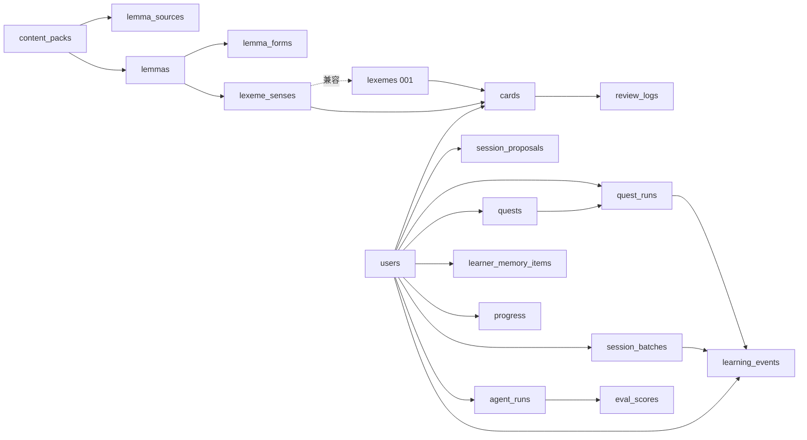

# 言灵残片 · 数据库字段字典与 ER

> 迁移：`supabase/migrations/001_text_foundation.sql` + `002_content_and_events.sql`  
> 顺序：先见 `docs/data-requirements.md`，再读本字段字典。  
> 日期：2026-10-25（Asia/Shanghai）  
> **地位（2026-11-09）**：这两份 SQL 仍是草案。仓库没有 Supabase 客户端，SQL 里没有 RLS。增量列、幂等键和 API 是设计，写在 [evolution-architecture.md](evolution-architecture.md) 第 3 节，不要把它们算进本字典的已有字段。

## ER（分层）



文字关系摘要：

- **内容包** `content_packs` → **lemma**（+ `lemma_sources` 溯源、`lemma_forms` 变体）→ **sense**（`lexeme_senses`；001 `lexemes` 兼容壳）
- **cards**：`(user × lexeme/sense × aspect)` FSRS；**LLM 不得改 due**
- **events**：`review_logs` / `quest_runs` / `agent_runs` / `session_proposals` / `learning_events` / `eval_scores`
- **memory**：`learner_memory_items` + `progress` 画像字段

---

## 字段字典

### content_packs

| 字段 | 类型 | Null | 默认 | 说明 |
|------|------|------|------|------|
| id | text | N | — | 主键，如 `ngsl-s-1.2` |
| name | text | N | — | 展示名 |
| version | text | N | — | 上游版本 |
| license | text | N | — | 如 `CC-BY-SA-4.0` |
| source_url | text | Y | null | 官网 |
| mirror_url | text | Y | null | 镜像 |
| citation | text | Y | null | 署名短文 |
| lemma_count | int | Y | null | 词条数 |
| coverage_note | text | Y | null | 覆盖率说明 |
| created_at | timestamptz | N | now() | 创建时间 |

### lemma_sources

| 字段 | 类型 | Null | 默认 | 说明 |
|------|------|------|------|------|
| id | text | N | — | 主键 |
| pack_id | text | N | — | FK → content_packs |
| lemma | text | N | — | 规范 lemma |
| freq_rank | int | Y | null | 包内频级（1=最高） |
| source_row | jsonb | N | `{}` | 原始行快照 |
| created_at | timestamptz | N | now() | |

Unique `(pack_id, lemma)`。

### lemmas

| 字段 | 类型 | Null | 默认 | 说明 |
|------|------|------|------|------|
| id | text | N | — | 如 `en_be` |
| lemma | text | N | — | 规范形 |
| lang | text | N | `en` | 语言 |
| pack_id | text | Y | null | FK → content_packs |
| freq_rank | int | Y | null | 主包频级 |
| cefr_est | text | Y | null | A1–C2 |
| topic_tags | jsonb | N | `[]` | 话题 |
| enrichment_status | text | N | `pending` | pending/partial/ready/blocked |
| created_at | timestamptz | N | now() | |

Unique `(lang, lemma)`。

### lemma_forms

| 字段 | 类型 | Null | 默认 | 说明 |
|------|------|------|------|------|
| id | text | N | — | 主键 |
| lemma_id | text | N | — | FK → lemmas |
| form | text | N | — | 变体拼写 |
| form_type | text | N | `inflected` | lemma/inflected/variant/contraction |
| created_at | timestamptz | N | now() | |

### lexeme_senses

| 字段 | 类型 | Null | 默认 | 说明 |
|------|------|------|------|------|
| id | text | N | — | sense 主键 |
| lemma_id | text | N | — | FK → lemmas |
| sense_key | text | N | — | 包内稳定键 `s1`… |
| orthography | text | N | — | 书写形 |
| phonetic_text | text | Y | null | IPA 文字；可空至 enrichment |
| gloss_zh | text | Y | null | 中文义 |
| gloss_en | text | Y | null | 上游/编辑英文短义 |
| example_sentence | text | Y | null | 英例句 |
| example_sentence_zh | text | Y | null | 中例句 |
| collocations | jsonb | N | `[]` | 搭配 |
| tags | jsonb | N | `[]` | 标签 |
| cefr | text | Y | null | A1–C2 |
| freq_rank | int | Y | null | 冗余频级便于查询 |
| enrichment_status | text | N | `pending` | 同上 |
| source_pack_id | text | Y | null | FK → content_packs |
| license_note | text | Y | null | 本行许可备注 |
| created_at | timestamptz | N | now() | |

### lexemes（001 + 002 ALTER）

沿用 001 非空形音义字段（demo seed）；002 增加：

| 字段 | 类型 | Null | 默认 | 说明 |
|------|------|------|------|------|
| lemma_id | text | Y | null | 指向 lemmas |
| enrichment_status | text | Y | `ready` | 旧 seed 默认 ready |
| source_pack_id | text | Y | null | 溯源包 |
| gloss_en | text | Y | null | 英文短义 |
| license_note | text | Y | null | 许可备注 |

> 新导入优先写 `lemmas` + `lexeme_senses`；`lexemes` 种子 JSON 作 001 兼容壳（pending 行允许空字符串占位）。

### cards / review_logs（001，沿用）

见 `001_text_foundation.sql`。要点：`aspect ∈ {form,meaning,phonology_text}`；`unique(user_id,lexeme_id,aspect)`；**应用层禁止 LLM 写 due/stability/scheduled_days**。  
002：`review_logs` 可选 `learning_event_id`、`agent_run_id`。

### session_batches（002）

| 字段 | 类型 | Null | 默认 | 说明 |
|------|------|------|------|------|
| id | text | N | — | 主键 |
| user_id | uuid | N | — | FK users |
| aspect | text | N | — | 单 aspect |
| lexeme_ids | jsonb | N | `[]` | ~5 词 |
| card_ids | jsonb | N | `[]` | 对应卡 |
| proposal_id | text | Y | null | 关联提案 |
| created_at | timestamptz | N | now() | |

### quests（001 + 002）

001 核心：title/goal/roles/student_knows/npc_knows/must_elicit/success_criteria/…  
002 增加：

| 字段 | 类型 | Null | 默认 | 说明 |
|------|------|------|------|------|
| origin | text | Y | `static` | static/generated |
| generated_by | text | Y | null | agent 名 |
| parent_quest_id | text | Y | null | 模板溯源 |
| topic_tags | jsonb | Y | `[]` | 话题 |
| eval_score | float8 | Y | null | 评估分 |

### quest_runs（001 + 002）

002 增加：`generated_by`、`parent_quest_id`、`must_elicit_hits`、`eval_score`、`abandon_reason`、`intent`。

### agent_runs

| 字段 | 类型 | Null | 默认 | 说明 |
|------|------|------|------|------|
| id | uuid | N | gen_random_uuid() | |
| user_id | uuid | Y | null | |
| agent | text | N | — | tide_steward 等 |
| tools | jsonb | N | `[]` | 调用工具列表 |
| input_ref | text | Y | null | |
| output_ref | text | Y | null | |
| cost_tokens | int | Y | null | |
| status | text | N | `ok` | ok/error/blocked/skipped |
| error_message | text | Y | null | |
| created_at | timestamptz | N | now() | |

### session_proposals

| 字段 | 类型 | Null | 默认 | 说明 |
|------|------|------|------|------|
| id | text | N | — | |
| user_id | uuid | N | — | |
| day_id | text | N | — | 用户时区 YYYY-MM-DD |
| intent | text | Y | null | 意图契约 |
| variants | jsonb | N | `[]` | 多提案 |
| chosen_id | text | Y | null | |
| user_edits | jsonb | N | `{}` | |
| load_estimate | jsonb | N | `{}` | |
| status | text | N | `draft` | draft/presented/accepted/rejected/expired |
| created_at | timestamptz | N | now() | |
| decided_at | timestamptz | Y | null | |

### learning_events

| 字段 | 类型 | Null | 默认 | 说明 |
|------|------|------|------|------|
| id | uuid | N | gen_random_uuid() | |
| user_id | uuid | N | — | |
| event_type | text | N | — | intent / retrieval_grade / must_elicit_hit / abandon … |
| session_batch_id | text | Y | null | |
| quest_run_id | uuid | Y | null | |
| card_id | text | Y | null | |
| agent_run_id | uuid | Y | null | |
| payload | jsonb | N | `{}` | |
| created_at | timestamptz | N | now() | |

### progress（001 + 002）

002：`error_type_counts`、`compliance_streak`、`wtc_proxy`（可空）、`last_intent`、`last_session_at`。

### learner_memory_items

| 字段 | 类型 | Null | 默认 | 说明 |
|------|------|------|------|------|
| id | uuid | N | gen_random_uuid() | |
| user_id | uuid | N | — | |
| kind | text | N | — | episode/preference/weak_lexeme/… |
| payload | jsonb | N | `{}` | 结构化记忆 |
| embedding_ref | text | Y | null | 外存向量引用 |
| salience | float8 | N | 0.5 | 显著度 |
| expires_at | timestamptz | Y | null | |
| created_at | timestamptz | N | now() | |
| updated_at | timestamptz | N | now() | |

### eval_scores

| 字段 | 类型 | Null | 默认 | 说明 |
|------|------|------|------|------|
| id | uuid | N | gen_random_uuid() | |
| suite | text | N | — | 评测套件名 |
| item_id | text | Y | null | |
| metric | text | N | — | |
| score | float8 | Y | null | |
| breach_flags | jsonb | N | `[]` | 策略违约 |
| agent_run_id | uuid | Y | null | |
| created_at | timestamptz | N | now() | |

---

## 迁移应用说明

本阶段可不连云；SQL 为 Postgres/Supabase 草案。本地可用同名字段 SQLite 对照。

```bash
# 有 Supabase CLI 时（示例）
supabase db reset   # 或按序 apply 001 → 002
```
